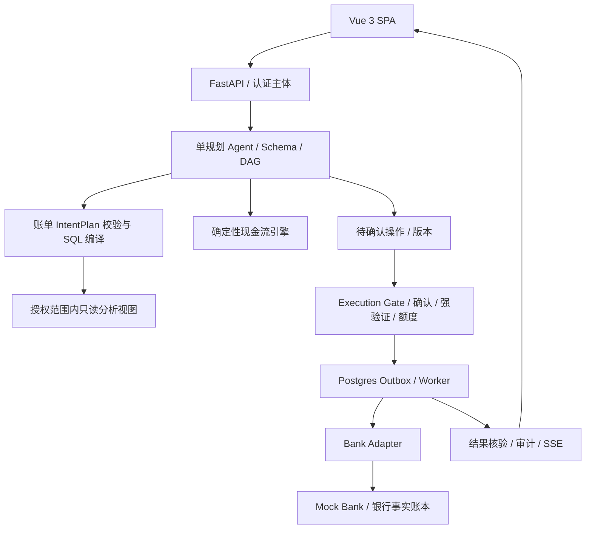

# 技术架构与 Text2SQL 路径

## 组件

|组件|技术|职责|
|---|---|---|
|Web|Vue 3 + TypeScript + Vite；Vue Router、Pinia、ECharts|银行首页、助手、未来账本、确认卡和任务中心|
|API|FastAPI + Pydantic + SQLAlchemy/Alembic|鉴权、结构化输入、计划版本、接口契约|
|规划|单 LLM provider adapter + 显式有限 DAG|意图、追问、任务分解、解释；无银行凭据|
|分析|语义目录 + 受控 IntentPlan + SQL 编译器|白名单指标/维度/过滤；参数绑定，固定关联|
|计算|Python 确定性现金流和汇总服务|整数分、有限日期搜索、约束校验|
|执行|PostgreSQL Outbox + 独立 Worker|租约、预约、核验、恢复；Redis 后置|
|存储|PostgreSQL，bank/app 两个 schema + 独立角色|银行事实、应用状态隔离；生产可分库|
|银行|独立 Mock Bank HTTP 服务 + adapter|账本、转账、代扣事实；以后替换官方接口|
|分析沙箱|隔离容器|只读脱敏快照，非 root、无网络、无密钥、限资源|
|部署|Docker Compose + SSE|统一环境；事件 ID 续传和数据库恢复|



## 前端实施基线

正式应用在 `apps/web/` 使用 Vue 单文件组件、Composition API 和 `<script setup lang="ts">`。Vue Router 对应七类页面；Pinia 保存会话、方案版本与任务显示状态，银行余额、授权与任务终态以 API 返回为准。SSE 封装于 composable，组件卸载释放连接，断线重连后查询权威状态。

Vite 负责开发/构建；部署为静态 SPA，Web 服务配置页面路径回退与 `/api` 反向代理。鉴权及授权仍由 FastAPI 执行，路由守卫仅改善交互，不替代后端鉴权。当前 HTML 原型继续用原命令预览，正式 Vue 工程尚未创建。

## 账单查询完整路径

认证主体 → 会话绑定 dataset_id + semantic_version + 账户范围 → 取受控语义目录 → LLM 输出 AnalysisPlan → Pydantic 严格验证 → 业务校验/必要追问 → 确定性编译参数化只读 SQL → 只读角色执行 → 数值/凭据 + 图表 → 解释。

模型不输出 SQL。请求也不允许携带 user_id 来选择访问主体。dataset_id 不能扩大当前主体的账户权限。SQL 模板包含认证主体过滤；生产还应使用 RLS 双重约束，连接池在事务内 SET LOCAL，连接回收不保留上一用户上下文。RLS 策略由拥有者/超级用户绕过的情况必须单独验证，应用不用这些角色。

允许字段：category、merchant、month、account；指标：gross_expense、refund、net_expense、income、transaction_count。枚举来自当前授权数据集；未知商户不删除过滤条件。‘排名前几’缺少指标要追问。‘最近’缺少定义先展示所用日期范围或追问。

例如：‘2026 年 9 月餐饮净支出多少？’

```json
{"kind":"analysis","dataset_id":"personal_ledger","semantic_version":1,"metric":"net_expense","start":"2026-09-01","end_exclusive":"2026-10-01","filters":{"category":"餐饮"},"group_by":null,"limit":100}
```

编译器只选择预定义表达式，所有用户值参数绑定；只允许单 SELECT、已注册表/视图/关联；设置 statement_timeout、行数上限和只读事务。退款可能在另一个月，不将原消费月静默重算。空结果显示 0/无记录并说明范围，不能解释成数据库故障。

首版不开放用户自定义 Join/SQL/指标表达式。业务分类可纠正但保留分类版本与来源。分析沙箱是额外统计通道，不替代金额 oracle；不能用 Python AST 检查冒充系统级隔离。

## 银行写路径与恢复

意图 → 补参 → 银行收款人验证 → 生成规范参数及 plan_version → 报价 → 确认 → 必要强验证 → 额度锁与最终校验 → 原子写 operation/outbox → Worker 提交稳定幂等键 → 查询银行状态 → 成功/失败/待查证。

即时确认默认 5 分钟；预约使用单独有效期和授权策略，到期重新检查额度、余额、银行能力和授权。日累计按本用户全部转账账户合计，含成功+预占+未知结果；数据库按用户和业务日加锁。两笔并发 600 元：第一笔黄色、第二笔累计 1200 元须红色，不能只在初次规划时检查。

银行角色才可写余额/账本。成功转账在银行事务内记录一对平衡分录并更新余额；外部收款人使用模拟清算对手账户。Agent 数据库不得直接修银行余额。

状态：DRAFT → NEEDS_INFO / NEEDS_CONFIRM → NEEDS_AUTH（如需）→ READY / SCHEDULED → SUBMITTING → SUCCEEDED / FAILED / PENDING_UNKNOWN。已提交后取消请求只阻止后续步骤；已成功动作补偿是新业务。未知结果保留额度，worker 重启后先查证。应用状态和 outbox 同事务；租约到期只能获得恢复权，不能自动再次付款。

## 实现顺序

先冻结契约和数据 → 不用 LLM 完成手动银行闭环 → 并发/幂等/丢回包恢复 → 三场景意图与 Text2SQL → 现金流/重规划 → 沙箱及整体测试 → 演示材料。银行接口不支持某能力返回 UNSUPPORTED，界面保留未完成状态。

## 技术资料

实现时参考 [PostgreSQL 行级安全](https://www.postgresql.org/docs/current/ddl-rowsecurity.html)、[事务隔离](https://www.postgresql.org/docs/current/transaction-iso.html)、[FastAPI 文档](https://fastapi.tiangolo.com/)、[Vue 工具链](https://vuejs.org/guide/scaling-up/tooling.html)、[Vue Router](https://vuejs.org/guide/scaling-up/routing.html)、[Pinia 选型依据](https://vuejs.org/guide/scaling-up/state-management.html)。这些链接不构成已实现的证明。
