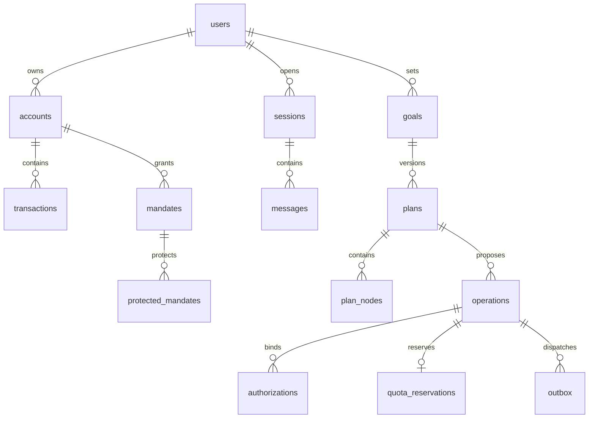

# 数据库、语义层和 API

## 事实、状态、分析三个域

`db/schema.sql` 是 PostgreSQL DDL 基线：bank 域保存银行事实；app 域保存意图、计划、授权及任务。它可以帮助团队讨论字段、主外键和索引，但尚未运行 PostgreSQL 验证，不包含生产角色授权、RLS、复式平衡延迟触发器或完整状态迁移约束，不能直接视为安全部署脚本。

|域|表|基数与职责|
|---|---|---|
|身份|users、sessions、messages|用户 1:N 会话，绑定语义版本和授权数据集|
|银行|accounts、recipients、transfers、transactions|用户 1:N 账户/收款人；账户 1:N 事实流水；银行外部 ID 去重|
|银行账本|journal_entries、journal_lines|一笔业务 1:N 分录，合计为0；清算对手腿也保存|
|代扣|mandates、protected_mandates、subscription_candidates|银行授权独立于用户保护偏好和模型推测|
|语义|datasets、dataset_grants|发布版本、可访问账户集合；不让用户任意注册 SQL|
|规划|goals、plans、plan_nodes、cashflow_events|目标 1:N 计划版本，每版本有事件/节点|
|执行|operations、authorizations、quota_days、quota_reservations|操作绑定计划版本；原子日额度；授权一次使用|
|恢复|outbox、audit_events|任务派发和可追溯事件；审计追加写权限另配置|

## 统一指标

- gross_expense：POSTED 且 kind=expense 且 direction=OUT 的正整数分合计。
- refund：POSTED 且 kind=refund 且 direction=IN 的正整数分合计，按退款入账月。
- net_expense：gross_expense − refund，可以为负；退款沿用原消费类别。
- income：POSTED 且 kind=income 且 direction=IN；不含退款和账户互转。
- transaction_count：范围内 POSTED 消费/退款笔数，不把同一业务在不同来源导入算两次。
- 月份：Asia/Shanghai 的 [月初00:00, 下月初00:00)，转换 UTC 参数执行，避免 UTC 月边界偏差。
- 不从历史流水推导当前余额，除非具备 opening_balance、全量覆盖与对账证明。

账户筛选不允许跨主体；标签查询不允许静默放宽条件。退款关联原流水，同类重复扣费但不同 external_id 保留为两笔、只标可疑；相同 external_id 的多次导入归一笔。

## API 契约基线

所有路径先鉴权。响应 `{data, error, request_id}`；错误含 `code,recoverable,next_action`。前端不用模型文字判断状态。下面是接口设计，当前仓库尚无运行这些接口的 API 服务。

|方法/路径|请求关键字段|响应/规则|
|---|---|---|
|GET /api/accounts|认证主体|账户事实和 as_of|
|POST /api/chat|session_id,text|task_id,plan_id,plan_version,missing_fields|
|POST /api/analysis|session_id,IntentPlan|确定性结果、evidence_ids、chart；不可提交 SQL|
|POST /api/plans/{id}/simulate|plan_version,assumptions|新版本、逐日余额、冲突、假设|
|POST /api/operations|plan_id,plan_version,selected_action|服务端参数快照与风险级别；不是已授权|
|POST /api/operations/{id}/confirm|plan_version,params_hash|短期授权；认证主体及参数须匹配|
|POST /api/operations/{id}/verify|独立认证凭证|单次 auth_ref；不进 LLM|
|POST /api/operations/{id}/execute|plan_version；Idempotency-Key header|202 + operation_id；Gate 重新检查|
|GET /api/operations/{id}|认证主体|权威状态、银行引用、下一行动|
|POST /api/tasks/{id}/cancel|version|仅未提交取消；提交中查证|
|GET /api/events|Last-Event-ID|仅本人事件；单调 event_id，断线续接|

Bank adapter：get_balance、list_transactions、resolve_recipient、quote_transfer、submit_transfer、get_transfer_status、list_mandates、cancel_mandate、get_mandate_status。写能力声明幂等支持、预约支持、查询支持；不支持返回 UNSUPPORTED。

错误集：NEEDS_INFO、UNKNOWN_ENUM、FORBIDDEN、AUTH_REQUIRED、AUTH_EXPIRED、PLAN_STALE、INSUFFICIENT_FUNDS、PENDING_UNKNOWN、UNSUPPORTED、UPSTREAM_UNAVAILABLE。未知结果不映射为 FAILED；明确失败后才能释放额度并允许新尝试。

## 并发和数据所有权

同用户的账户/收款人采用复合外键，阻止只替换 account_id 的跨主体引用。JSON 字段内的账户、金额、日期仍须服务端 Schema 与摘要验证，数据库外键不会自动检查 JSON。生产分析走只读投影/快照，不给 LLM 或沙箱 bank schema 凭据。

银行账本和 app 状态跨系统不强求原子提交。先持久化提交意图，银行回包不明进入待查证，用稳定银行引用恢复；不宣称跨系统恰好一次。每日额度业务日不能使用机器默认时区。
